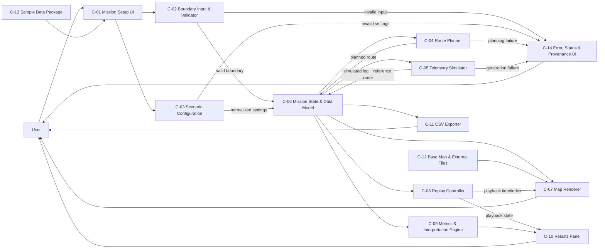
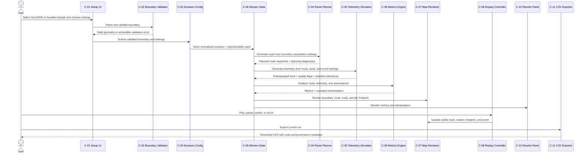

# Fieldline Search Mission Replay — Product and Engineering Specification

**Status:** Handoff specification for the next coding agent  
**Product:** Fieldline Search Mission Replay (working name)  
**Version:** 0.1  
**Last updated:** 2026-10-22  
**Primary scenario:** Simulated nighttime search and rescue (SAR)  
**Intended implementation:** Small browser application; no live aircraft connection and no full flight simulator

## 1. Purpose

Build a self-contained, reviewable proof of concept that demonstrates an end-to-end geospatial mission-analysis workflow:

1. A user provides a search-area boundary.
2. The application validates the boundary and mission settings.
3. The application generates a repeatable search route.
4. The application synthesizes a timestamped flight track that follows the route, with configurable deterministic variation.
5. The user watches the simulated mission replay on an interactive map.
6. The application summarizes route execution, approximate geometric coverage, and data-quality events, and allows the simulated log to be downloaded.

The prototype is intended to make mission data and the analysis workflow understandable to a viewer. It is an educational/portfolio demonstration, not flight planning, operational SAR guidance, a sensor-performance model, a target detector, or flight-control software.

## 2. Product decision and scope

### 2.1 Chosen first scenario

The first and only named mission scenario is **nighttime search and rescue**. A user may choose a sensor *assumption* (thermal or visible-light) to alter explanatory text. This selection does not model sensor physics or detection performance. Wildlife tracking and wildfire response are future scenarios and must not be represented as supported in this version.

### 2.2 Meaning of “fly the mission”

“Fly” means animate a synthetic aircraft marker along a generated route using synthetic telemetry. The proof of concept does not connect to a real drone, autopilot, simulator, or live feed. All UI surfaces and exports must label synthetic flight data as simulated.

### 2.3 In scope

- Import a GeoJSON Polygon or MultiPolygon search boundary.
- Load a bundled sample boundary.
- Configure route pattern, nominal altitude, assumed sensor/swath, random seed, and optional simulated GPS-quality event.
- Generate parallel-sweep and crosshatch routes within the supported boundary geometry.
- Generate reproducible simulated telemetry from the route and seed.
- Animate/replay the track with play, pause, restart, and timeline scrubbing.
- Show search-area boundary, planned route, flown track, current aircraft location, and nominal sensor footprint.
- Compute and explain a small set of descriptive metrics with their assumptions and limitations.
- Export the simulated telemetry as CSV.
- Provide useful validation and error states; support desktop and narrow-screen layouts.

### 2.4 Explicitly out of scope

- Real vehicle control, upload of a flight plan to an aircraft, or execution through PX4/ArduPilot/SITL.
- Real flight-log ingestion or format parsing (ULog, DataFlash, MAVLink telemetry, GPX, etc.).
- Digital elevation model (DEM), terrain occlusion, buildings, obstacles, airspace, weather, or no-fly-zone processing.
- Camera or thermal image simulation, detection probability, person/animal detection, or claims that a target was or was not observed.
- Multi-user accounts, cloud persistence, backend services, mission sharing, or database.
- Operational recommendations or safety-critical decisions.
- Wildlife tracking and wildfire scenarios in v0.1.

## 3. Current prototype baseline

The current implementation is a single-page browser prototype in [`index.html`](index.html), with a bundled sample in [`data/sample_search_area.geojson`](data/sample_search_area.geojson) and usage/limitations in [`README.md`](README.md).

Current visible capabilities include an interactive Leaflet map, sample area, GeoJSON upload, route pattern and scenario-assumption controls, seeded simulated track, replay controls, basic metrics, narrative text, and CSV export.

The current implementation is a starting point, not a validated baseline. In particular, the current track generator stores its noisy simulated position as the planned reference, which makes the route-deviation comparison invalid. Coverage is a crude route-distance-times-swath estimate that can overcount turns, overlap, and areas outside the polygon. MultiPolygon islands/holes are not planned independently. These must be corrected or clearly marked as unsupported before calling the metrics meaningful. Do not preserve existing formulas merely because they are present in the prototype.

## 4. Users and primary use case

### 4.1 Primary user

A developer, student, hiring manager, or technical stakeholder exploring how geospatial mission inputs can become a generated route, simulated log, and readable post-mission summary.

### 4.2 Primary job to be done

“Given a search polygon and a few explicit assumptions, show me a repeatable simulated search mission, let me inspect its progress, and explain what the generated data does and does not support.”

### 4.3 Success criteria

A first-time viewer can, without editing code:

- Load the sample or a valid GeoJSON area.
- Configure and generate a mission.
- Visually distinguish planned route from simulated flown track.
- Play, pause, restart, and scrub the mission.
- See metrics and an interpretation consistent with the exported log.
- Download the log and reproduce the same run by reusing its scenario settings and seed.

## 5. Component catalog (stable reference IDs)

Use these IDs in implementation notes, pull requests, issues, and future specs. IDs are stable even if filenames change.

| ID | Component | Responsibility |
|---|---|---|
| **C-01** | Mission Setup UI | Collect boundary file, mission pattern, sensor assumption, altitude, swath, seed, and optional GPS event; initiate generation. |
| **C-02** | Boundary Input & Validator | Parse GeoJSON; validate supported geometry, coordinate order/ranges, ring closure, finite coordinates, and usable polygon area; return actionable errors. |
| **C-03** | Scenario Configuration | Normalize user inputs into one canonical scenario object and retain the settings needed to reproduce/export a run. |
| **C-04** | Route Planner | Convert the supported polygon and route settings into ordered planned waypoints/segments; preserve the search boundary and avoid unintended connector segments across excluded areas. |
| **C-05** | Telemetry Simulator | Create deterministic timestamped simulated positions and quality flags along the planned route; keep planned and observed values separate. |
| **C-06** | Mission State & Data Model | Hold the active scenario, boundary, planned route, telemetry, metrics, playback index, and generated status consistently for all UI components. |
| **C-07** | Map Renderer | Render basemap, boundary, planned route, flown track, aircraft marker, and nominal footprint with legend and clear visual hierarchy. |
| **C-08** | Replay Controller | Play/pause/restart, scrub timeline, update elapsed-time display, and synchronize marker/track/event state to telemetry. |
| **C-09** | Metrics & Interpretation Engine | Derive transparent descriptive metrics from generated route/log and assumptions; create cautious, data-grounded narrative. |
| **C-10** | Results Panel | Present metrics, units, assumptions, quality-event state, and interpretation without implying detection or operational certainty. |
| **C-11** | CSV Exporter | Export timestamped simulated telemetry and enough run metadata to identify scenario settings, units, and synthetic-data status. |
| **C-12** | Base Map & External Tiles | Provide geographic context through an online tile provider with attribution and graceful offline/degraded state. |
| **C-13** | Sample Data Package | Ship a valid, documented SAR search-boundary GeoJSON and reproducible default scenario. |
| **C-14** | Error, Status & Provenance UI | Show validation errors, generation/replay states, selected input, synthetic-data labels, and limitations. |

## 6. System architecture diagram



## 7. End-to-end workflow



## 8. Functional requirements

Requirement IDs are stable references. “Must” indicates release-blocking behavior for this proof of concept.

### 8.1 Mission input and configuration

- **FR-001 (C-01/C-02):** The user must be able to load a local GeoJSON file through a file picker. Do not require a backend upload.
- **FR-002 (C-02):** Accept a GeoJSON `Feature`, `FeatureCollection`, `Polygon`, or `MultiPolygon` only when it contains supported polygon geometry. If scope needs to be reduced, explicitly accept one Polygon and reject unsupported/multipart cases with a clear message; never silently analyze only one island.
- **FR-003 (C-02):** Validate JSON syntax, geometry type, coordinate arrays, finite longitude/latitude values, longitude in [-180, 180], latitude in [-90, 90], closed rings, at least three distinct vertices, and non-zero area. Errors must identify the issue and keep the previous valid scenario intact.
- **FR-004 (C-02/C-07):** Interpret GeoJSON coordinate positions as `[longitude, latitude]`; render in correct location and fit the map to the loaded boundary.
- **FR-005 (C-01/C-03):** Provide a bundled sample boundary and a reset/load-sample action. Show the active boundary name or filename.
- **FR-006 (C-01/C-03):** For v0.1, provide the single scenario “Nighttime search and rescue.” The sensor selection is an assumption label only (thermal or visible-light); it must not alter detection claims.
- **FR-007 (C-01/C-03):** Support pattern selection (parallel sweep; crosshatch), nominal altitude in meters, nominal swath width in meters, integer seed, and a toggle for one deterministic simulated GPS-quality dip.
- **FR-008 (C-03/C-06):** Validate numeric values and enforce documented limits/defaults. Reject invalid values rather than silently substituting them. Reusing the same boundary, settings, and seed must reproduce the same route, telemetry, and analysis.
- **FR-009 (C-03/C-14):** Display defaults and units. Record assumptions with the run; do not imply altitude or swath values were measured from a real vehicle/sensor.

### 8.2 Route planning

- **FR-010 (C-04):** Generate a planned route that is visibly contained within the supported search geometry, with a configurable swath-based line spacing and ordered segments.
- **FR-011 (C-04):** Parallel-sweep routes must alternate adjacent scan direction where feasible to reduce transit distance.
- **FR-012 (C-04):** Crosshatch routes must include a second sweep orientation, while marking the additional time/overlap as part of the scenario. Route rendering must distinguish turns/transit from search legs if metrics treat them differently.
- **FR-013 (C-04):** Preserve separate route segments or explicit segment types (`search`, `transit`, `turn`) so the simulator and metrics do not treat jumps between clipped line intervals as sensor search passes.
- **FR-014 (C-04/C-14):** If the polygon is too small, malformed, or otherwise cannot produce a valid route, show a recoverable message and do not present stale results as the new run.
- **FR-015 (C-04):** The route is a visualization/planning demonstration only. Do not claim it is airworthy, optimized, terrain-safe, legally compliant, or ready to upload to an aircraft.

### 8.3 Synthetic flight and replay

- **FR-016 (C-05):** Generate timestamped simulated positions along planned route segments with stable sampling interval and plausible, documented positional variation.
- **FR-017 (C-05/C-06):** Store planned position and simulated observed position as distinct fields. Metrics must compare observed positions to the corresponding planned reference; observed coordinates must never be reused as the reference.
- **FR-018 (C-05):** If enabled, create one deterministic GPS-quality dip with a start/end time or sample interval. Quality status and uncertainty behavior must be visible in replay and exported data.
- **FR-019 (C-05/C-14):** Mark every screen, narrative, and exported dataset as simulated/synthetic. The user must not mistake the animation for live telemetry.
- **FR-020 (C-08):** Support play, pause, replay from start, and arbitrary seeking through the timeline. Playback must stay synchronized with elapsed time, marker, flown track, footprint, and quality-event annotation.
- **FR-021 (C-07/C-08):** Show a distinct planned route and actual simulated track; provide legend and clear current-position marker. Do not obscure the boundary or imply the footprint is a verified sensor observation.
- **FR-022 (C-08):** The interface must remain responsive during replay for the sample polygon and a documented upper bound on supported area/track samples.

### 8.4 Metrics and interpretation

- **FR-023 (C-09):** Report simulated duration from telemetry timestamps, not a hard-coded constant detached from sample count.
- **FR-024 (C-09):** Report route deviation using a defined method, such as mean and maximum cross-track distance from the planned route. Document units and treatment of turns/transit. Verify against controlled synthetic cases.
- **FR-025 (C-09):** Report estimated geometric coverage using a defensible method that accounts for the boundary, swath width, search legs, overlap, and excluded areas to the level claimed. If the implementation is only a rough corridor approximation, label it as such and avoid precision beyond its method.
- **FR-026 (C-09):** Report quality-event state and interval from generated telemetry. If no event is configured, state “No simulated GPS-quality dip included,” not “GPS was good.”
- **FR-027 (C-09/C-10):** Generate narrative only from computed metrics and explicit scenario assumptions. Explain at least one relevant limitation. Do not assert target detection, target absence, real-world flight safety, or sensor effectiveness.
- **FR-028 (C-10):** Metrics and narrative must update whenever a new mission is generated and must all refer to the same active run.
- **FR-029 (C-09/C-10):** Include an explanation that estimated geometric coverage is not equivalent to usable imagery, sensor detection, or successful search coverage.

### 8.5 Map, export, and status

- **FR-030 (C-07/C-12):** Render an interactive map with map attribution. If external tiles are unavailable, show an understandable degraded/offline state while retaining mission data and non-map results where feasible.
- **FR-031 (C-11):** Export a CSV containing at minimum: timestamp in seconds, observed latitude/longitude, planned latitude/longitude, position-quality state, nominal altitude in meters, scenario, sensor assumption, and seed. Include units and synthetic provenance in header fields or a companion metadata section/file.
- **FR-032 (C-11):** Export must use the currently displayed run. The filename must identify it as simulated, e.g. `simulated_flight_log_<run-id>.csv`.
- **FR-033 (C-14):** Provide visible states for ready, generating, generated, replaying, paused, completed, and error. Errors must be actionable and must not be reported only through browser alerts.
- **FR-034 (C-14):** Clearly disclose the non-operational nature and modeled/unmodeled assumptions on the page and in exported metadata.

## 9. Data contracts

Implementation may use JavaScript objects, JSON, or typed structures, but preserve these semantic fields.

### 9.1 Scenario configuration (`MissionScenario`)

```json
{
  "scenario_id": "night_sar",
  "scenario_label": "Nighttime search and rescue",
  "boundary_source": "sample_search_area.geojson",
  "boundary_geometry": "Polygon",
  "pattern": "parallel_sweep",
  "sensor_assumption": "thermal",
  "altitude_m": 60,
  "swath_width_m": 100,
  "seed": 42,
  "simulate_gps_quality_dip": true,
  "synthetic": true
}
```

Allowed values: `scenario_id=night_sar`; `pattern=parallel_sweep|crosshatch`; `sensor_assumption=thermal|visible_light`. Numeric ranges must be stated in UI/help text and enforced consistently. Store or export the polygon coordinates or a stable hash/name so the run can be associated with its input.

### 9.2 Planned route waypoint (`PlannedWaypoint`)

```json
{
  "sequence": 0,
  "latitude": 37.827,
  "longitude": -122.501,
  "altitude_m": 60,
  "segment_type": "search",
  "leg_id": "search-001"
}
```

Coordinate convention in application objects is explicit named `latitude`/`longitude`; GeoJSON input remains `[longitude, latitude]`.

### 9.3 Telemetry sample (`TelemetrySample`)

```json
{
  "timestamp_s": 0,
  "planned_latitude": 37.827,
  "planned_longitude": -122.501,
  "latitude": 37.82701,
  "longitude": -122.50098,
  "altitude_m": 60,
  "position_quality": "good",
  "horizontal_uncertainty_m": 2.5,
  "segment_type": "search",
  "synthetic": true
}
```

Use `position_quality=good|degraded`; define uncertainty meaning. Samples must be time-ordered and timestamps monotonic. For the current synthetic GPS dip, deterministic uncertainty should increase during the marked interval; positional noise may increase as well, but the modeled behavior must be documented.

### 9.4 Analysis result (`MissionAnalysis`)

```json
{
  "duration_s": 0,
  "mean_route_deviation_m": 0,
  "max_route_deviation_m": 0,
  "estimated_geometric_coverage_pct": 0,
  "coverage_method": "documented method identifier",
  "gps_quality_events": [],
  "limitations": ["Synthetic data; no sensor detection is modeled."],
  "interpretation": "..."
}
```

Do not put fabricated numeric precision in the UI. Metrics should be computed from the same data represented in the replay and CSV.

## 10. Geometry and metric methodology expectations

The next implementation should choose and document a practical local projection for the search area (for example, a local tangent/equirectangular approximation for small areas, or an established projection library) and define acceptable area bounds. Avoid mixing degrees and meters in distance/area calculations.

The route planner should work on a projected representation in meters, clip scan lines against polygon rings, and output explicit search legs. Handle or explicitly reject holes and multipart geometry. Do not silently discard geometry.

For route deviation, compute distance from each simulated observed location to its corresponding planned interpolation/route segment. A position-quality event should increase modeled uncertainty; the deviation metric should still be based on observed-versus-planned positions and should disclose the event interval.

For coverage, a defensible v0 method may rasterize the polygon into cells and mark cells intersected by the swath buffers of search segments, then calculate covered cells divided by eligible polygon cells. Document cell size, boundary handling, overlap handling, and the assumed footprint. A simpler buffer-union method is acceptable if it is implemented correctly and documented. Merely multiplying total flown distance by swath width is not a sufficient area-coverage calculation when routes overlap or include transit/turns.

The footprint circle is a nominal visualization from `swath_width_m / 2`; it is not a camera frustum or validated sensor footprint. Label it **assumed footprint**.

## 11. User interface and interaction details

### Mission setup panel

- Boundary upload and active filename/sample label.
- Search scenario (fixed to nighttime SAR in v0.1; show as selected scenario rather than exposing unsupported scenario choices).
- Pattern, sensor assumption, altitude, swath width, seed, GPS-quality dip toggle.
- Primary **Generate & run mission** action.
- Secondary **Load sample area** and **Export simulated log** actions.
- Inline validation and generation state.

### Map and playback

- Boundary polygon fill and outline.
- Dashed or muted planned route; solid contrasting simulated flown track.
- Moving aircraft marker and a translucent nominal footprint.
- Current GPS-quality event annotation when the playhead intersects its interval.
- Legend, map attribution, and selected-area framing.
- Play/pause, restart, timeline seek, elapsed/total time.

### Results and interpretation

- Duration, mean/max route deviation, estimated geometric coverage, and quality event summary.
- Units and short tooltip/help for method/assumption.
- Cautious plain-language interpretation that references observed run data.
- Persistent “simulated data / not evidence of detection” disclosure.

## 12. Error handling and edge cases

- Malformed JSON, unsupported geometry, empty FeatureCollection, invalid coordinate ranges, unclosed rings, duplicate/degenerate vertices, zero-area polygon.
- Very small polygon relative to swath/scan spacing; route with no search legs.
- MultiPolygon with separated islands, polygons with holes, concave polygons producing multiple scan intervals.
- Invalid altitude/swath/seed; blank values; extreme values that make the map or route unreasonable.
- Regeneration while a previous replay timer is active; ensure timer cancellation and no stale marker/metrics/export.
- Seeking while paused or completed; restarting after completion; exporting before a run exists.
- Offline or failed map tiles; Leaflet/CDN unavailable; browser file access limitations.
- Long tracks that could make per-frame redraw slow; cap or optimize supported sample count.

## 13. Non-functional requirements

- **NFR-001 Reproducibility:** Same canonical inputs and seed produce byte-for-byte-equivalent route/telemetry values where practical, aside from non-deterministic metadata such as run timestamp.
- **NFR-002 Transparency:** Every output is traceable to scenario settings, input boundary, route, seed, and declared method.
- **NFR-003 Data honesty:** Synthetic and assumed values are always identified; never present them as measured flight or sensor data.
- **NFR-004 Usability:** A new viewer can complete a sample run and understand replay controls without reading source code.
- **NFR-005 Robustness:** Invalid user files do not crash the page or replace the last valid run with partial results.
- **NFR-006 Privacy:** Boundary files are processed locally in the browser; no upload to a service. External basemap requests may reveal the viewed map area to the tile provider; disclose this in README/UI.
- **NFR-007 Attribution:** Keep required basemap attribution visible. Honor data licensing and retain provenance for any added map data.
- **NFR-008 Maintainability:** Separate route planning, telemetry generation, metrics, rendering/replay, and export logic into modules or clearly bounded functions. Avoid further expanding the current monolithic inline script.
- **NFR-009 Accessibility:** Controls have labels, keyboard-accessible replay actions, visible focus, sufficient contrast, and non-color-only event/status cues.
- **NFR-010 Performance:** On a typical laptop, sample mission generation should complete in under 2 seconds and replay controls should remain responsive. Document a maximum boundary extent and track sample count for v0.1.

## 14. Suggested implementation structure

Refactor the single HTML prototype into a small, dependency-light structure (or equivalent framework structure if the repository owner chooses):

```text
SAR Mission Replay/
├── index.html
├── README.md
├── POC-SPEC.md
├── data/
│   └── sample_search_area.geojson
├── src/
│   ├── app.js                 # UI wiring and run lifecycle
│   ├── boundary.js            # GeoJSON parse/validation/projection
│   ├── scenario.js            # defaults and canonical configuration
│   ├── route-planner.js       # search/transit segment generation
│   ├── telemetry.js           # seeded track and event generation
│   ├── analysis.js            # deviation, coverage, interpretation
│   ├── map-view.js            # Leaflet layers and map state
│   ├── replay.js              # play/pause/restart/seek
│   └── export.js              # CSV and run metadata
└── styles.css
```

No framework or package manager is mandated. Keep local execution straightforward. If CDN dependencies remain, document that network access is required and provide a clear degraded state.

## 15. Acceptance criteria for v0.1 handoff

The work is complete when all of the following are true:

1. A new user can open the application, load the sample GeoJSON, generate a run, and see the animated replay without changing code. (FR-005, FR-016, FR-020)
2. A user can upload a valid custom polygon and see the boundary and generated route in the correct location. (FR-001–FR-004, FR-010)
3. Invalid input produces an inline error and does not corrupt or silently replace the active valid run. (FR-003, FR-014, FR-033)
4. Planned route and simulated track are separate data and separate visual layers. (FR-017, FR-021)
5. Same boundary/settings/seed generate the same route and telemetry; changing the seed changes the modeled variation. (FR-008, NFR-001)
6. Route-deviation computation compares observed telemetry against its independent planned reference and has a controlled known-offset case demonstrating the result. (FR-024)
7. Coverage method is documented and accounts for polygon bounds, search legs, swath, and overlap to the degree claimed; UI wording matches its limitations. (FR-025, FR-029)
8. Replay controls synchronize the marker, track, footprint, clock, and GPS event interval, including after restart and seek. (FR-018, FR-020)
9. CSV contains timestamps, observed and planned positions, quality, altitude, sensor assumption, seed, units/provenance, and identifies the data as simulated. (FR-031, FR-032)
10. Summary text is computed from the active run and never says a target was detected/not detected or that the area was truly searched successfully. (FR-027, FR-028)
11. The app clearly states that it is not connected to or controlling a real aircraft and sensor behavior is not simulated. (FR-019, FR-034)
12. README includes run instructions, supported input geometry, dependency/network notes, limitations, and data attribution/provenance. (NFR-006, NFR-007)

## 16. Verification plan

The coding agent should verify the acceptance criteria with focused automated checks where practical and a short manual browser pass. At minimum:

- Geometry validation cases: sample polygon, valid custom polygon, malformed JSON, unsupported LineString, out-of-range coordinates, zero-area polygon, and multipart/hole behavior according to stated support.
- Determinism: same seed equality and changed-seed variation.
- Route geometry: all search-leg samples lie within eligible polygon area; no hidden jumps across excluded intervals.
- Metrics: zero-noise route has near-zero deviation; a known offset produces the expected positive deviation; coverage handles overlap without exceeding 100% and has sensible small/large-area behavior.
- Replay lifecycle: play, pause, seek, restart, completion, and regenerate while active.
- Export: parse CSV and verify fields/units/provenance and current-run identity.
- Manual UI: sample workflow, uploaded file workflow, invalid file message, offline tile behavior, narrow viewport.

Do not claim acceptance from code inspection alone. Report which checks were run and any remaining limitations.

## 17. Risks and decisions to preserve

- This project demonstrates analysis workflow, not SAR effectiveness. Avoid sensational language or false assurance.
- Sensor type and nominal swath are assumptions; neither implies a target can be seen at night.
- Coverage and route-quality metrics must not be more precise than their actual geometry/method.
- Real maps and uploaded search areas can be sensitive. Keep GeoJSON local; explain external basemap tile requests.
- Later real-log ingestion will require explicit adapters and metadata/time synchronization, not simply treating a CSV as equivalent to this synthetic log.
- Keep the initial scenario singular. Add wildfire or wildlife only after the SAR flow and data model are stable, with scenario-specific inputs and metrics defined in a separate spec update.

## 18. Handoff instructions for the coding agent

1. Read this spec and the existing [`README.md`](README.md), [`index.html`](index.html), and sample boundary before editing.
2. Treat **C-01 through C-14** and **FR/NFR IDs** as references; preserve IDs when updating this document. Add new IDs rather than renumbering existing ones.
3. Fix data-model correctness before polishing visuals—especially independent planned-vs-observed positions, valid route segments, and coverage methodology.
4. Keep the v0.1 scenario as simulated nighttime SAR. Do not add real flight control or target detection.
5. Update README and this spec if implementation behavior or supported geometry changes.
6. At handoff, summarize completed component IDs, acceptance criteria verified, commands/checks run, and known gaps.
